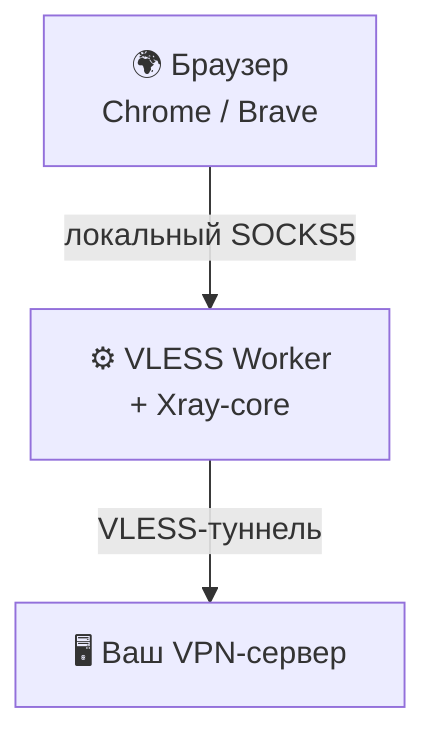

<div align="center">


# vless-eevee 🦊

**Private proxy. Just for your browser.**

Лёгкий VLESS-прокси для Chrome, Brave и Chromium.
Подключайся к своим серверам прямо из браузера — остальные приложения не затрагиваются.

<br>


<br>

[**⬇️ Скачать**](https://github.com/evangelion3131/vless-extension/releases)
&nbsp;•&nbsp;
[📥 Установка](#-установка)
&nbsp;•&nbsp;
[🚀 Использование](#-использование)
&nbsp;•&nbsp;
[❓ FAQ](#-faq)
&nbsp;•&nbsp;
[🛠 Разработка](#-разработка)

</div>

<br>

---

## 📖 О проекте

`vless-eevee` позволяет использовать VLESS-серверы прямо в браузере, не затрагивая интернет-соединение остальных приложений.

> **Как это выглядит:** добавьте ссылку на подписку → выберите сервер → нажмите «Подключить». Весь трафик браузера пойдёт через выбранный прокси.

## ✨ Возможности

| | Возможность | Описание |
|:-:|---|---|
| 🌐 | **Только для браузера** | Telegram, Discord, игры и другие приложения используют обычное соединение |
| 🔗 | **Подписки** | Ссылка на подписку или отдельная VLESS-ссылка |
| 📋 | **Единый список** | Все VLESS-серверы из подписки в одном месте |
| 📊 | **Пинг и скорость** | Сравните задержку и скорость скачивания, сортируйте серверы по результатам |
| 🛡 | **Исключения по сайтам** | Откройте текущий сайт напрямую, не отключая прокси для остальных вкладок |
| ⚡ | **Быстрое переключение** | Нажмите на другой сервер — подключение переключится автоматически |
| 👥 | **Несколько профилей** | Профили браузера используют общий туннель; отключение в одном не отключает остальные |
| 🔍 | **Проверка IP** | Посмотрите внешний IP-адрес браузера в один клик |
| 🛟 | **Автовосстановление** | Если прокси или Worker остановились — браузер вернётся к обычному подключению |
| 🌙 | **Работа в фоне** | Worker стартует вместе с системой, открытое окно не нужно |

---

## 📥 Установка

Для работы нужны **две части**:

| Компонент | Что делает |
|---|---|
| 🧩 **Расширение браузера** | Интерфейс: подписки, список серверов, управление подключением |
| ⚙️ **VLESS Worker** | Фоновая программа, которая подключается к серверу через Xray-core |

Обычно обе части ставятся одним установщиком из раздела Releases.

### 1️⃣ Скачайте установщик

👉 **[Последняя версия vless-eevee](https://github.com/evangelion3131/vless-extension/releases)**

| Система | Файл |
|---|:-:|
| Windows 10/11 (64-bit) | `.msi` |
| macOS (Intel / Apple Silicon) | `.pkg` |
| Linux Mint / Ubuntu / Debian (amd64, ARM64) | `.deb` |

### 2️⃣ Установите программу

<details open>
<summary><b>🪟 Windows</b></summary>

<br>

1. Запустите скачанный `.msi`.
2. Если появится запрос контроля учётных записей — разрешите установку.
3. Дождитесь завершения.

</details>

<details>
<summary><b>🍎 macOS</b></summary>

<br>

1. Откройте скачанный `.pkg`.
2. Следуйте инструкциям установщика.

> [!NOTE]
> Установщики проекта могут быть без подписи разработчика. Если macOS предупредит о неизвестном разработчике — проверьте источник файла.

</details>

<details>
<summary><b>🐧 Linux Mint / Ubuntu / Debian</b></summary>

<br>

В папке со скачанным файлом выполните:

```bash
sudo apt install ./vless-eevee_*.deb
```

Либо откройте `.deb` через менеджер пакетов.

</details>

### 3️⃣ Установите расширение

На **Linux**,**Windows** и **macOS**:

1. Скачайте `extension-*.zip` из раздела **Assets** на странице релиза.
2. Распакуйте архив в удобную папку.
3. Откройте страницу расширений:

   | Браузер | Адрес |
   |---|---|
   | Chrome / Chromium | `chrome://extensions` |
   | Brave | `brave://extensions` |

4. Включите **Режим разработчика**.
5. Нажмите **Загрузить распакованное расширение**.
6. Выберите распакованную папку и убедитесь, что расширение появилось в списке.

### 4️⃣ Перезапустите браузер

Полностью закройте браузер и откройте снова, затем нажмите на значок **vless-eevee** в панели расширений.

✅ **Готово!**

---

## 🚀 Использование

### 🔗 1. Добавьте подписку

Подписка — это ссылка от вашего VPN-провайдера со списком серверов.

1. Откройте расширение.
2. Вставьте ссылку в поле ввода.
3. Нажмите **«+»** и дождитесь загрузки серверов.

```text
https://provider.com/sub/xxxxxxxx
```

Или добавьте отдельную VLESS-ссылку:

```text
vless://uuid@server.example.com:443?security=tls&type=tcp#MyServer
```

> [!IMPORTANT]
> Используйте именно ссылку подписки или VLESS-ссылку, полученную от своего провайдера.

### 🖥 2. Выберите сервер

Выберите сервер из списка. Если провайдер изменил список — нажмите **↻**, чтобы обновить подписку.
Для сравнения серверов используйте кнопки пинга и скорости или запустите замер для всего списка. Тест скорости скачивает 5 МБ с `speed.cloudflare.com` через выбранный сервер.
Кнопка **«Добавить текущий сайт в исключения»** направит сайт и его поддомены напрямую. Список можно изменить в **Настройки → Исключения**.

### ⚡ 3. Подключитесь

Нажмите **«Подключить»** рядом с сервером. Браузер начнёт использовать выбранный прокси.

### 🔍 4. Проверьте подключение

Нажмите **«IP?»** — расширение покажет внешний IP-адрес. Если он изменился на адрес вашего сервера, всё работает.

Для дополнительной проверки: [2ip.io](https://2ip.io/) · [browserleaks.com/ip](https://browserleaks.com/ip)

### 🔌 5. Отключитесь

Нажмите **«Отключить»** — браузер вернётся к обычному соединению. Остальные приложения всё это время работают напрямую.

---

## 🌐 Как это работает



Программа **не перенаправляет системный трафик**. Прокси включается только в настройках самого браузера.

---

## ❓ FAQ

<details>
<summary><b>Расширение не подключается</b></summary>

<br>

- Убедитесь, что VLESS Worker установлен
- Проверьте, что фоновая служба запущена
- Перезапустите браузер
- Попробуйте другой сервер

</details>

<details>
<summary><b>Список серверов не загружается</b></summary>

<br>

- Проверьте правильность ссылки
- Убедитесь, что подписка доступна и не просрочена
- Попробуйте открыть ссылку в обычном браузере
- Нажмите кнопку обновления **↻**

</details>

<details>
<summary><b>Подключение есть, но сайты не открываются</b></summary>

<br>

- Проверьте работоспособность сервера и его портов
- Попробуйте другой сервер
- Убедитесь, что системное время выставлено правильно — оно влияет на TLS и REALITY

</details>

<details>
<summary><b>После установки расширение не появляется</b></summary>

<br>

- Выбрана должна быть папка `extension`, а не корень проекта
- Включите режим разработчика
- На Windows и macOS расширение загружается вручную (или устанавливается из Chrome Web Store, если версия опубликована)

</details>

<details>
<summary><b>После отключения прокси интернет не работает</b></summary>

<br>

Отключите прокси в расширении и перезапустите браузер. Если проблема осталась — проверьте настройки прокси в браузере.

</details>

<details>
<summary><b>Нужно ли держать терминал или окно программы открытым?</b></summary>

<br>

Нет. Worker работает в фоне и запускается средствами операционной системы.

</details>

---

## ⚠️ Известные ограничения

- Требуется **Chrome 116** или новее
- Подписки обновляются только вручную (**↻**), автообновления по расписанию пока нет
- Нет автоматического выбора самого быстрого сервера
- В режиме списка ссылок поддерживается только VLESS; VMess, Trojan и Shadowsocks пропускаются
- Готовые JSON-конфигурации Xray поддерживаются отдельно и могут содержать другие протоколы
- Некоторые провайдеры ограничивают загрузку подписок по User-Agent и другим параметрам
- Нет маршрутизации отдельных сайтов (через прокси / напрямую)
- Установщики Windows и macOS могут показывать предупреждения — они не подписаны сертификатами разработчика

> [!WARNING]
> **WebRTC может раскрывать ваш реальный IP-адрес.** Если это важно, используйте дополнительные средства защиты от WebRTC-утечек.

## 🔒 Безопасность и открытый код

`vless-eevee` — проект с открытым исходным кодом. Вы можете изучить код расширения и Worker, собрать всё из исходников или проверить отдельные компоненты.

- 📦 [Исходный код](https://github.com/evangelion3131/vless-extension)
- 🏷 [Готовые версии (Releases)](https://github.com/evangelion3131/vless-extension/releases)

> [!CAUTION]
> Не передавайте посторонним ссылку на подписку и VLESS-конфигурацию: они содержат UUID и другие данные, которые позволяют подключиться к вашему серверу.

---

## 🛠 Разработка

> Раздел для разработчиков и тех, кто хочет собрать проект самостоятельно.

### 🗂 Структура проекта

```text
vless-eevee/
├── extension/       # Chrome Extension (Manifest V3)
└── helper/          # Native Messaging Worker на Go
    ├── install/     # Установочные файлы и скрипты
    └── ...
```

### 🧱 Архитектура

| Компонент | Роль |
|---|---|
| `extension/` | Интерфейс, список серверов, включение/отключение прокси через `chrome.proxy` |
| `helper/` | Нативный компонент на Go: принимает команды через Native Messaging, генерирует конфигурацию Xray, управляет процессом Xray-core |
| `xray-core` | Подключается к VLESS-серверу и поднимает локальный SOCKS5-прокси |

### 📄 Поддерживаемые форматы подписок

Подписки обрабатываются автоматически.

**1. Готовая конфигурация Xray (JSON)**

Конфигурации с `outbounds` — одним объектом или массивом. Используются почти без изменений: сохраняются routing-правила, DNS и другие настройки провайдера. Заменяется только блок `inbounds`, чтобы использовать свободный локальный SOCKS-порт.

**2. Список ссылок**

Base64, Base64 URL-safe или обычный текст (по одной ссылке в строке). Разбираются VLESS-ссылки.

| Параметр | Значения |
|---|---|
| Транспорт | `tcp`, `ws`, `grpc` |
| Шифрование | `tls`, `reality`, `none` |
| Дополнительно | `flow`, `sni`, `fp`, `pbk`, `sid`, `alpn`, `path`, `host` |

### 🔨 Сборка Worker

Нужен [Go 1.21+](https://go.dev/dl/). Worker не имеет сторонних зависимостей.

```bash
cd helper
```

| Платформа | Команда |
|---|---|
| macOS Apple Silicon | `GOOS=darwin GOARCH=arm64 go build -o install/helper .` |
| macOS Intel | `GOOS=darwin GOARCH=amd64 go build -o install/helper .` |
| Linux x64 | `GOOS=linux GOARCH=amd64 go build -o install/helper .` |
| Linux ARM64 | `GOOS=linux GOARCH=arm64 go build -o install/helper .` |
| Windows x64 | `GOOS=windows GOARCH=amd64 go build -ldflags -H=windowsgui -o install/helper.exe .` |

### 📦 Установка Xray-core

Скачайте релиз с [XTLS/Xray-core](https://github.com/XTLS/Xray-core/releases):

| ОС | Архив |
|---|---|
| macOS Apple Silicon | `Xray-macos-arm64-v8a.zip` |
| macOS Intel | `Xray-macos-64.zip` |
| Linux x64 | `Xray-linux-64.zip` |
| Linux ARM64 | `Xray-linux-arm64-v8a.zip` |
| Windows x64 | `Xray-windows-64.zip` |

Извлеките файлы в `helper/install/` (в Windows — с расширением `.exe`):

```text
helper/install/
├── helper
├── xray
├── geoip.dat
└── geosite.dat
```

> [!NOTE]
> `geoip.dat` и `geosite.dat` нужны для routing-правил вроде `geoip:ru` и `geosite:category-ru`. Без них некоторые конфигурации Xray не запустятся.

### 🧪 Ручная установка Worker

Для тестирования распакованной версии расширения:

<details>
<summary><b>🐧 Linux</b></summary>

```bash
cd helper/install
chmod +x install-linux.sh
./install-linux.sh
```

Скрипт регистрирует Native Messaging host для Chrome, Chromium и Brave.

</details>

<details>
<summary><b>🍎 macOS</b></summary>

```bash
cd helper/install
chmod +x install-macos.sh
./install-macos.sh
```

</details>

<details>
<summary><b>🪟 Windows (PowerShell)</b></summary>

```powershell
cd helper\install
powershell -ExecutionPolicy Bypass -File install-windows.ps1
```

</details>

ID расширения передавать не нужно — он уже указан в конфигурации проекта.

### 🏗 Сборка установщиков

Установщики собираются автоматически через GitHub Actions: **MSI** (Windows), **PKG** (macOS), **DEB** (Debian / Ubuntu / Mint).

- При пуше Git-тега, начинающегося с `v` (например `v0.1.0`), установщики прикрепляются к GitHub Release
- При ручном запуске workflow файлы доступны в разделе **Artifacts**
- Установщики включают Worker, Xray-core и Geo-базы

### 🖥 Особенности по ОС

| ОС | Как устроено |
|---|---|
| 🐧 **Linux** | Системная служба `vless-eevee-worker.service` (systemd, перезапуск при сбое), CRX и Native Messaging manifests. Конфигурация: `/var/lib/vless-eevee` |
| 🍎 **macOS** | LaunchDaemon `com.vless.eevee.worker` и системные Native Messaging manifests |
| 🪟 **Windows** | Worker запускается установщиком и добавляется в автозапуск через реестр. Конфиги: `%APPDATA%\vless-eevee` (не в `Program Files`) |

На Windows и macOS локальный CRX принудительно не устанавливается — используйте ручную загрузку распакованной папки или версию из Chrome Web Store, если она опубликована.

### 🗑 Удаление

| ОС | Как удалить |
|---|---|
| 🐧 Linux | Удалите пакет через менеджер пакетов. Служба, политики и manifests удалятся, данные в `/var/lib/vless-eevee` сохранятся |
| 🍎 macOS | `sudo helper/packaging/uninstall-macos.sh` |
| 🪟 Windows | «Установленные приложения» или MSI-деинсталлятор |

---

## 🗺 Планы развития

- [x] Поддержка URL подписок
- [x] Поддержка JSON-конфигураций Xray
- [x] Установщики для Windows, macOS и Linux
- [x] Проверка пинга и скорости серверов
- [ ] Автоматическое обновление подписок
- [ ] Защита от WebRTC-утечек
- [ ] Публикация в Chrome Web Store

---

<div align="center">

**Лицензия:** см. файл [`LICENSE`](LICENSE)

Сделано с 🦊 для приватного браузинга

</div>